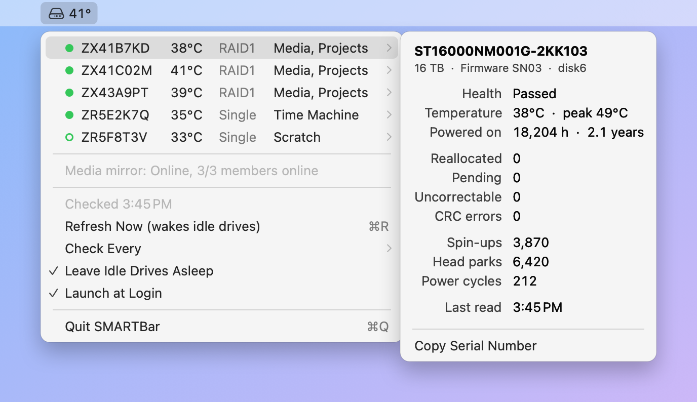
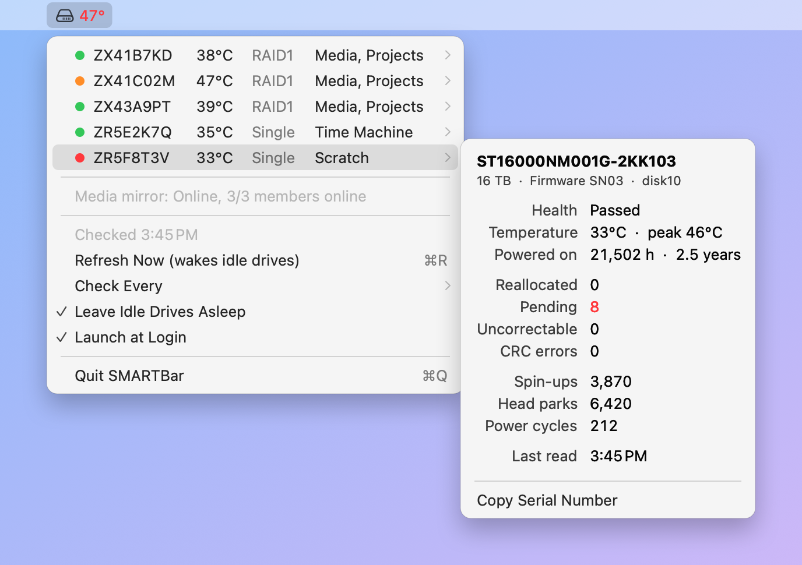

# SMARTBar

A small macOS menu bar app that shows the SMART health and temperature of your external drives, including drives in USB enclosures that most SMART apps can't see without a kernel driver.

<picture>
  <source media="(prefers-color-scheme: dark)" srcset="Screenshots/menu-dark.png">
  
</picture>

The menu bar shows the temperature of the hottest drive. The menu lists each drive with a status indicator, serial number, temperature, arrangement (Single, RAID1, RAID0 or JBOD) and the volumes it holds. Each drive has a detail panel with its model, firmware, power-on hours, bad-sector counts and spin-up counts.

When something needs attention, the indicator and the menu bar temperature change colour:

<picture>
  <source media="(prefers-color-scheme: dark)" srcset="Screenshots/warning-dark.png">
  
</picture>

| Colour | Meaning |
|---|---|
| Green | Nothing to report |
| Orange | 45°C or hotter, reallocated sectors, or interface CRC errors |
| Red | 55°C or hotter, pending or uncorrectable sectors, a failed SMART health check, or a degraded Apple RAID set |

The images above are drawn from sample data by `SMARTBar --screenshots`, so they show the layout but not the exact look of a native menu.

## How it works

SMARTBar has no SMART code of its own. It runs [`smartctl`](https://www.smartmontools.org) from smartmontools for each external physical disk and reads its JSON output. It only reads: it never starts self-tests or changes drive settings.

- **No kernel extension.** If `smartctl -a /dev/diskN` works for your enclosure in Terminal, SMARTBar works too.
- **Drives are identified by their own serial number,** read through the enclosure, so bays that all report the same USB name and serial are still told apart.
- **Volumes and RAID membership come from `diskutil`,** including Apple RAID sets and the APFS volumes on them.

### Sleeping drives

Reading SMART data can spin up a sleeping drive, and many USB bridges can't report whether a drive is asleep. With **Leave Idle Drives Asleep** on (the default), SMARTBar skips any drive that has had no disk activity since its last reading and keeps showing the previous values. Skipped drives are marked with a ring instead of a filled dot.

The first check after launch and **Refresh Now** read every drive and can wake sleeping ones.

## Requirements

- macOS 13 or later
- To build from source: Xcode or the Xcode command line tools, and smartmontools (`brew install smartmontools`)

## Build and run

```sh
git clone https://github.com/jameshmcvay/SMARTBar.git
cd SMARTBar
./build.sh
open build/SMARTBar.app
```

`build.sh` compiles with `swiftc` directly and signs the app ad hoc. There is no Xcode project. Move `build/SMARTBar.app` to `/Applications` before turning on **Launch at Login**.

There are no prebuilt downloads, and the app is not notarised.

## Options

| Menu item | What it does |
|---|---|
| Refresh Now | Reads every drive immediately, including idle ones |
| Check Every | Sets the interval: 5, 15, 30 or 60 minutes (default 15) |
| Leave Idle Drives Asleep | Skips drives with no activity since the last reading |
| Launch at Login | Starts SMARTBar when you log in |

The temperature thresholds are two constants at the top of `Sources/Smart.swift`.

## Releasing

`./release.sh <version>` builds a universal app with `smartctl` bundled, signs it with a Developer ID, and produces a notarised DMG. Add `--publish` to tag the version and create the GitHub release. The one-time setup is described at the top of the script.

## Command line

```sh
build/SMARTBar.app/Contents/MacOS/SMARTBar --dump                  # print one reading of every drive
build/SMARTBar.app/Contents/MacOS/SMARTBar --screenshots <folder>  # regenerate the README images
```

## Limitations

- Only external physical disks are listed. Internal drives are not shown.
- It has been used with one enclosure: a five-bay TerraMaster with ASMedia USB-to-SATA bridges, holding SATA hard drives. Other enclosures should work if `smartctl` can read them, but are untested.
- The "peak" temperature comes from a field that Seagate drives use for their lifetime maximum. On other makes it may be missing or mean something else.
- There are no notifications and no history. You see a problem when you look at the menu bar.
- It can't go on the Mac App Store, because a sandboxed app can't run `smartctl` or query disks directly.

## Licence

MIT. See [LICENSE](LICENSE).

smartmontools is a separate project under the GPL (version 2 or later). An app built with `build.sh` runs your installed copy. A release built with `release.sh` bundles an unmodified `smartctl` as a separate program, with its licence inside the app and its exact source archive published next to the download. `vendor-smartctl.sh` is the build recipe.
